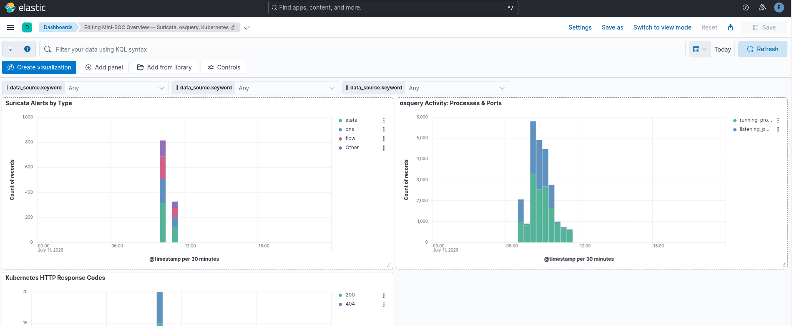
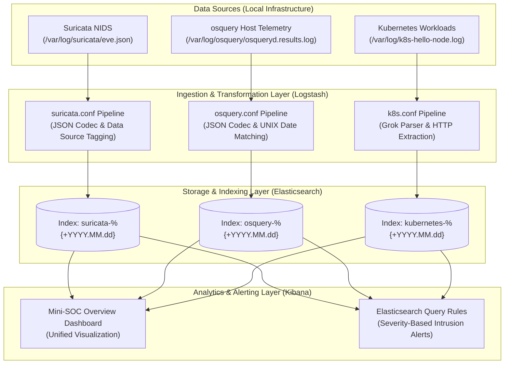
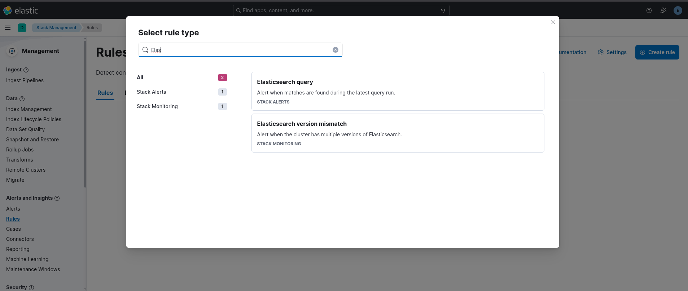
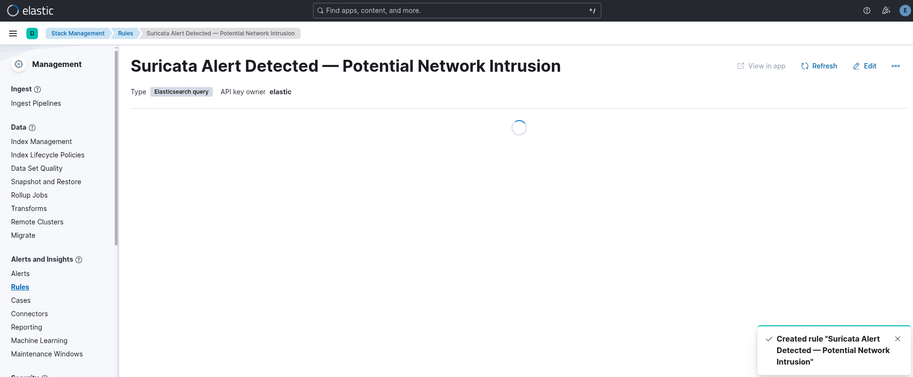
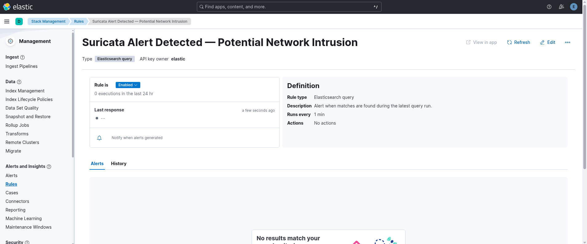
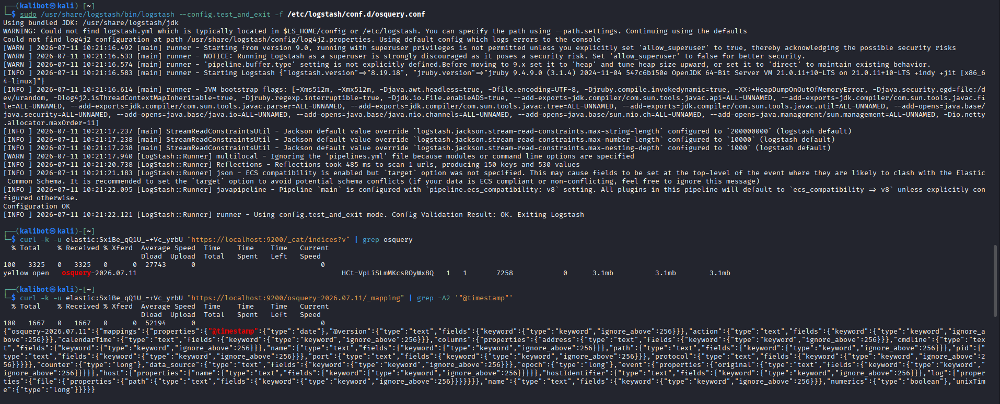
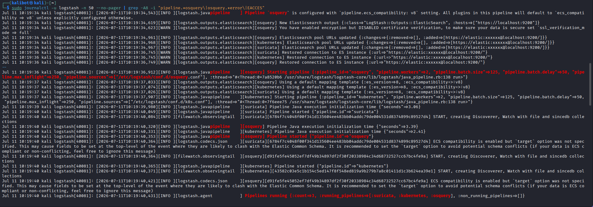
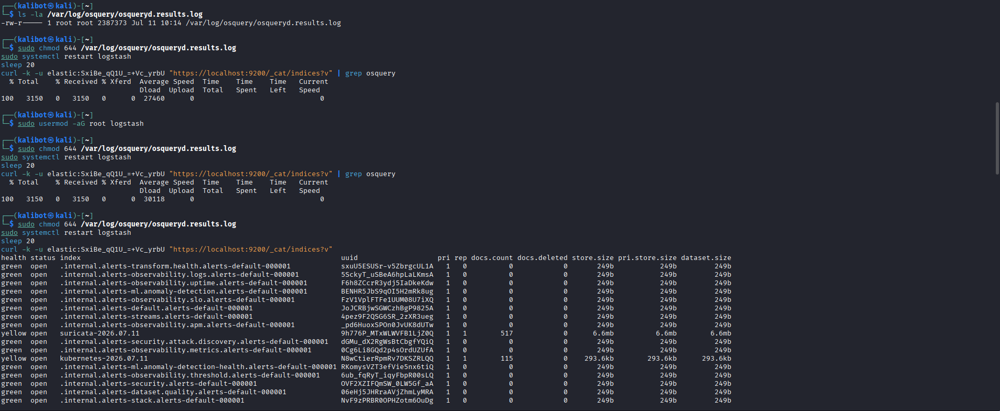
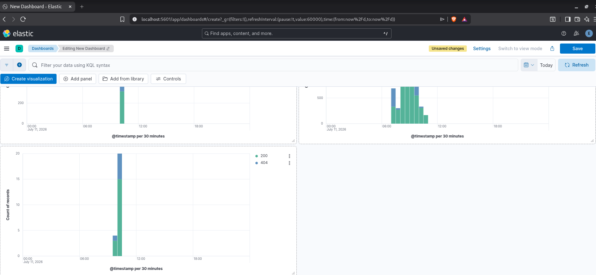

# Elastic Stack Mini-SOC — Local Security Operations & Threat Monitoring Architecture

[](https://www.elastic.co/elasticsearch/)
[](https://www.elastic.co/kibana/)
[](https://www.elastic.co/logstash/)
[](https://suricata.io/)
[](https://osquery.io/)
[](https://kubernetes.io/)

A local, zero-cloud Security Operations Center (SOC) telemetry and analytics platform built on the Elastic Stack (Elasticsearch, Logstash, Kibana). This environment correlates multi-layer threat data—combining Network Intrusion Detection (Suricata NIDS), Host/Endpoint Visibility (osquery), and Container Workload Telemetry (Kubernetes)—into a centralized, searchable SIEM dashboard with detection rules.

---

## 🎯 Production Deliverable: Mini-SOC Overview Dashboard


*Figure 1: Production Kibana Mini-SOC Overview Dashboard correlating Network Intrusion Detection (Suricata), Endpoint Host Telemetry (osquery), and Container Workload Metrics (Kubernetes).*

---

## Technical Architecture & Blueprint

The architecture is designed to fulfill strict local infrastructure constraints (no cloud provider dependencies) by streaming event data from three distinct telemetry domains through custom Logstash ingestion pipelines into an Elasticsearch cluster.



---

## Data Source Ingestion Pipelines

Each data source is processed by a dedicated Logstash pipeline configured in `configs/logstash/`.

### 1. Suricata Network Intrusion Detection (`configs/logstash/suricata.conf`)
Ingests Suricata's EVE JSON output log containing network flow, DNS queries, HTTP metadata, and signature-based IDS alerts.
- **Input**: File reader targeting `/var/log/suricata/eve.json` using the `json` codec.
- **Filter**: Mutates fields to append `data_source => "suricata"`.
- **Output Index**: `suricata-%{+YYYY.MM.dd}`

```logstash
input {
  file {
    path => "/var/log/suricata/eve.json"
    start_position => "beginning"
    sincedb_path => "/dev/null"
    codec => json
  }
}

filter {
  mutate {
    add_field => { "data_source" => "suricata" }
  }
}

output {
  elasticsearch {
    hosts => ["https://localhost:9200"]
    ssl_verification_mode => "none"
    user => "elastic"
    password => "${ELASTIC_PASSWORD}"
    index => "suricata-%{+YYYY.MM.dd}"
  }
}
```

### 2. osquery Endpoint Host Visibility (`configs/logstash/osquery.conf`)
Collects host OS state data (running processes, listening network ports, file modifications, socket events) generated by scheduled osquery queries.
- **Input**: File reader monitoring `/var/log/osquery/osqueryd.results.log` with JSON decoding.
- **Filter**: Standardizes event timestamps by parsing the `unixTime` key into `@timestamp` and tags events with `data_source => "osquery"`.
- **Output Index**: `osquery-%{+YYYY.MM.dd}`

```logstash
input {
  file {
    path => "/var/log/osquery/osqueryd.results.log"
    start_position => "beginning"
    sincedb_path => "/dev/null"
    codec => json
  }
}

filter {
  mutate {
    add_field => { "data_source" => "osquery" }
  }
  date {
    match => ["unixTime", "UNIX"]
    target => "@timestamp"
  }
}

output {
  elasticsearch {
    hosts => ["https://localhost:9200"]
    ssl_verification_mode => "none"
    user => "elastic"
    password => "${ELASTIC_PASSWORD}"
    index => "osquery-%{+YYYY.MM.dd}"
  }
}
```

### 3. Kubernetes Workload Telemetry (`configs/logstash/k8s.conf`)
Parses container access and application logs from local Kubernetes workloads (e.g. Minikube node service logs).
- **Input**: File reader pointing to `/var/log/k8s-hello-node.log`.
- **Filter**: Applies Grok pattern matching to extract client IP, HTTP request path, response code, and bytes sent. Tags events with `data_source => "kubernetes"`.
- **Output Index**: `kubernetes-%{+YYYY.MM.dd}`

```logstash
input {
  file {
    path => "/var/log/k8s-hello-node.log"
    start_position => "beginning"
    sincedb_path => "/dev/null"
  }
}

filter {
  mutate {
    add_field => { "data_source" => "kubernetes" }
  }

  grok {
    match => { "message" => "%{IPORHOST:client_ip} - - \[%{HTTPDATE:timestamp}\] \"%{WORD:http_method} %{URIPATHPARAM:request_path} HTTP/%{NUMBER:http_version}\" %{NUMBER:response_code} %{NUMBER:bytes_sent}" }
    tag_on_failure => ["_grokparsefailure_skipped"]
  }
}

output {
  elasticsearch {
    hosts => ["https://localhost:9200"]
    ssl_verification_mode => "none"
    user => "elastic"
    password => "${ELASTIC_PASSWORD}"
    index => "kubernetes-%{+YYYY.MM.dd}"
  }
}
```

---

## Detection Engineering & Alerting Rules

The platform incorporates automated detection rules configured in Kibana Alerting (`configs/rules/suricata-alert-rule.json`) to continuously monitor ingested network events for high-priority security incidents.

### Suricata Intrusion Detection Rule (`suricata-alert-rule.json`)
- **Rule Name**: `Suricata Alert Detected — Potential Network Intrusion`
- **Rule Type**: `elasticsearch` query rule running every `1m`.
- **Target Index Pattern**: `suricata-*`
- **Query Expression**:
  ```kql
  event.dataset: "suricata" AND suricata.eve.alert.severity <= 2
  ```
- **Severity Scope**: Captures High (`severity: 1`) and Medium (`severity: 2`) NIDS alerts, such as exploit attempts, malware C2 traffic, command injection signatures, and unauthorized network probes.

### Detection Rule Implementation Evidence


*Figure 2: Selecting Elasticsearch query rule type in Kibana Alerting & Insights.*


*Figure 3: Confirmation toast verifying successful creation and registration of the Suricata NIDS query detection rule.*


*Figure 4: Active Suricata detection rule dashboard in Kibana Stack Management displaying enabled state, 1-minute execution interval, and zero failures.*

---

## Operational Log & Troubleshooting Record

During system deployment and integration, key configuration validation and permission resolution steps were performed:

### 1. Logstash Configuration Validation
Before deploying pipelines to production, each configuration file was syntax-tested using the Logstash CLI:
```bash
sudo /usr/share/logstash/bin/logstash --config.test_and_exit -f /etc/logstash/conf.d/osquery.conf
```
*Result*: `Configuration OK` — Config Validation Result: OK.


*Figure 5: Terminal verification showing Logstash configuration test exiting with `Configuration OK` and Elasticsearch mapping audit.*

### 2. Resolving File Permission & Access Issues (`EACCES`)
Initial ingestion runs faced file access failures because `/var/log/osquery/osqueryd.results.log` was created with restrictive permissions (`-rw-r----- root root`). The issue was resolved by adjusting permissions and adding the `logstash` system user to the `root` group:
```bash
sudo chmod 644 /var/log/osquery/osqueryd.results.log
sudo usermod -aG root logstash
sudo systemctl restart logstash
```
*Verification*: System journal logs (`journalctl -u logstash`) confirmed successful execution of all 3 pipelines:
```text
Pipelines running {:count=>3, :running_pipelines=>[:suricata, :kubernetes, :osquery], :non_running_pipelines=>[]}
```


*Figure 6: Systemd journal output (`journalctl -u logstash -n 50`) confirming all 3 pipelines (`suricata`, `kubernetes`, and `osquery`) running without failure.*

### 3. Elasticsearch Index Health & Mapping Audit
Live index creation and document counts were verified via the Elasticsearch REST API:
```bash
curl -k -u elastic:${ELASTIC_PASSWORD} "https://localhost:9200/_cat/indices?"
```
*Indexed Telemetry Summary*:
- `suricata-2026.07.11`: 517 documents (6.6 MB)
- `kubernetes-2026.07.11`: 115 documents (293.6 KB)
- `osquery-2026.07.11`: 7,258 documents (3.1 MB)


*Figure 7: Terminal session resolving `/var/log/osquery/osqueryd.results.log` permissions and querying `_cat/indices` to confirm healthy document ingestion across indices.*

---

## Unified Kibana Dashboard Walkthrough

The **Mini-SOC Overview — Suricata, osquery, Kubernetes** dashboard aggregates telemetry across network, endpoint, and container infrastructure:


*Figure 8: Flagship Mini-SOC Overview dashboard displaying real-time correlated telemetry.*


*Figure 9: Dashboard panel layout and visualization editor in Kibana.*

### Panel Details & Metrics:
1. **Suricata Alerts by Type**: A time-series histogram tracking network event distribution across categories (`stats`, `dns`, `flow`, and signature alerts).
2. **osquery Activity: Processes & Ports**: Dual-metric time-series panel displaying total active processes (`running_processes`) vs open network sockets (`listening_ports`).
3. **Kubernetes HTTP Response Codes**: Histogram categorizing web workload status codes (`200 OK` vs `404 Not Found`).

---

## Secrets Management & Hardening

To align with security best practices:
- **Credential Redaction**: Plaintext passwords in configuration files have been replaced with the environment variable placeholder `${ELASTIC_PASSWORD}`.
- **Environment Variable Usage**: Logstash supports environment variable substitution natively. Set `ELASTIC_PASSWORD` in `/etc/default/logstash` or your environment file prior to starting the service.

---

## Repository Structure

```text
Elastic-Mini-SOC/
├── Elastic_Stack_Mini_SOC_Project_Brief.docx  # Project specification & requirements
├── README.md                                  # Production documentation (this file)
├── configs/
│   ├── logstash/
│   │   ├── k8s.conf                           # Kubernetes log ingestion pipeline
│   │   ├── osquery.conf                       # osquery telemetry ingestion pipeline
│   │   └── suricata.conf                      # Suricata NIDS log ingestion pipeline
│   └── rules/
│       └── suricata-alert-rule.json           # Kibana alerting rule definition
└── screenshots/
    ├── Dash.png                               # Unified Mini-SOC Kibana dashboard
    ├── Dashboard.png                          # Dashboard panel configuration view
    ├── Rule.png                               # Kibana detection rule type selection
    ├── Rule-Dash.png                          # Active Suricata detection rule details
    ├── Suricata-Rule.png                      # Kibana detection rule setup state
    ├── T2.png                                 # Logstash multi-pipeline running status log
    ├── T3.png                                 # Permission troubleshooting & index verification
    └── Troubleshooting.png                    # Config test & Elasticsearch mapping verification
```
